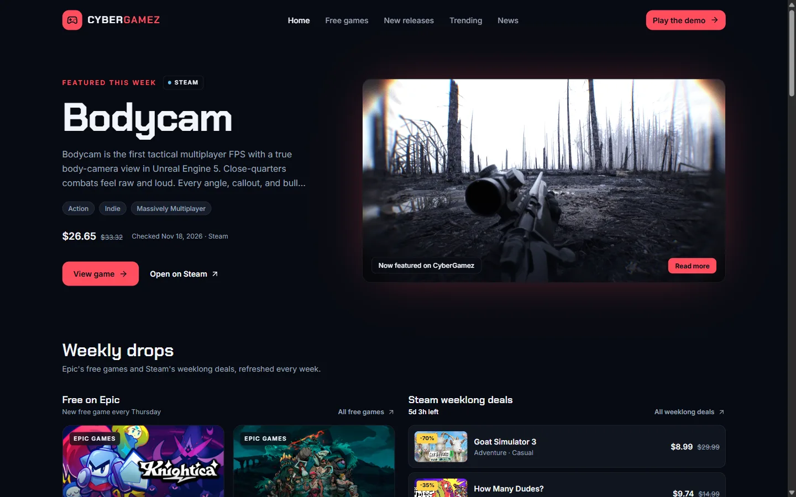

# CyberGamez

A game storefront and news site: new Steam and Epic releases, free games, weekly
deals, price checks and gaming headlines in one place.

Live: **https://cybergamez.vercel.app**

[](https://github.com/AymenBoukadida/cybergamez/actions/workflows/ci.yml)
[](https://github.com/AymenBoukadida/cybergamez/actions/workflows/sync-live.yml)
[](LICENSE)



## What is on it

- **Weekly drops** — Epic's free games for this week and next, next to Steam's
  weeklong deals, with countdowns.
- **Trending and new releases** — what is popular and what just launched on Steam.
- **Deals** — Steam specials, biggest discount first.
- **Cheapest price** — when another store sells a game for less, the card and game
  page link you to that price. Otherwise the page says the listed price is already
  the lowest it tracks.
- **News** — patch notes and studio updates.
- **Game pages** — artwork, genres, developer, price, screenshots and a link to the
  official store.

Prices are informational and always link to official stores. This is a portfolio
project, not affiliated with any publisher.

## How the site stays current

The pages are built ahead of time so they open fast, but the data is not frozen. A
scheduled job refreshes everything from Steam, Epic and CheapShark every six hours,
rebuilds the site and publishes it. That is how new releases, deals and headlines
show up without anyone editing the site. The footer and game pages show when the
data was last checked, and countdowns keep ticking in your browser between
refreshes.

## Run it locally

You need Node.js 20.9 or newer.

```bash
npm ci
npm run dev
```

Open `http://localhost:3000`. `npm run build` writes the static site to `out/`, and
`npm run preview` serves that build. `npm run sync` pulls fresh data (needs network
access).

## Built with

Next.js (static export), React, TypeScript and Tailwind CSS, with Swiper, Radix and
lucide. Tests run on Vitest.

## Credits

- Game artwork and screenshots belong to their publishers; sources are listed in
  [`assets/SOURCES.md`](assets/SOURCES.md).
- Fonts: [Inter](https://rsms.me/inter/) and
  [Chakra Petch](https://fonts.google.com/specimen/Chakra+Petch) via Fontsource.

## License

[MIT](LICENSE). The licence covers the code, not the game artwork.
